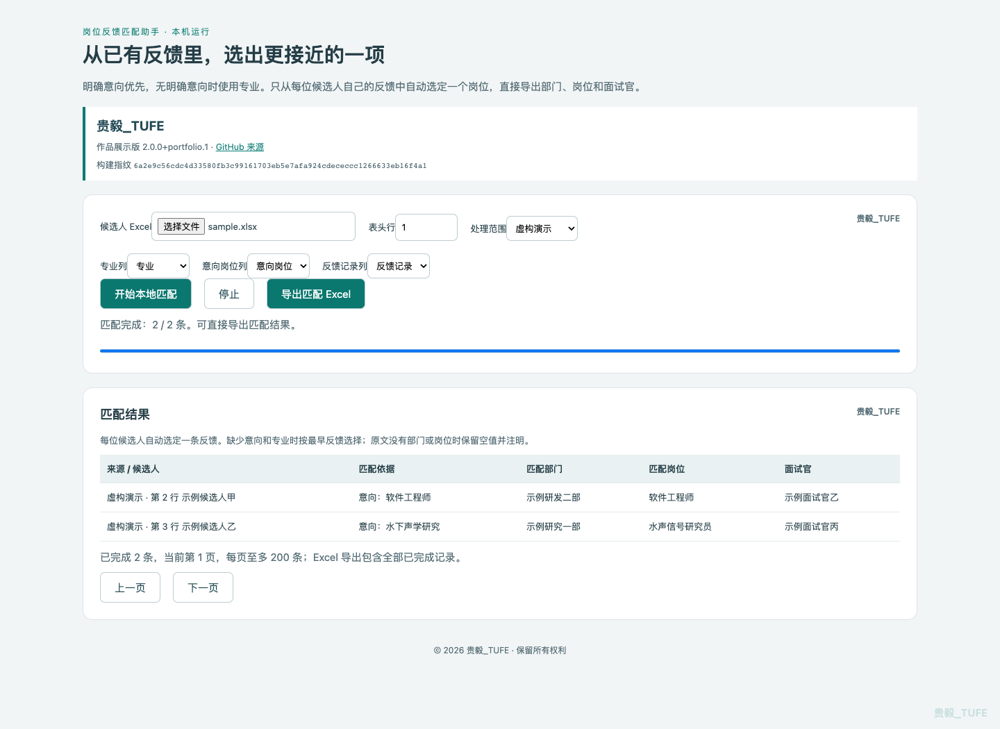

# 岗位反馈匹配助手

**贵毅_TUFE** · 作品展示版 2.0.0+portfolio.1  
[GitHub 项目来源](https://github.com/liguiyi-hash/job-feedback-matcher) · [版本说明](CHANGELOG.md)

从候选人已经收到的部门反馈中选取较合适的一项，批量输出部门、岗位和面试官。基于用户提供的「岗位反馈匹配助手.zip」整理，不是前一个候选人管理平台。

## 功能与实现

- Excel 单表、多工作表导入和列映射。
- 明确意向优先，无明确意向时使用专业。
- 同名岗位及职能规则优先，未覆盖方向使用 BAAI/bge-small-zh-v1.5 补充比较。
- 相同岗位和业务内优先较早反馈；缺少有效信息时按原有策略处理。
- 批量导出结果，保留工作表、原始行号和反馈原文。

本项目使用预训练模型进行推理，不是自行训练的招聘模型。匹配分支是岗位分配辅助，不代表胜任能力、录用概率或招聘准确率。

## 界面



页面显示贵毅_TUFE和GitHub来源，面板、页脚及角落保留水印；不遮挡表格和按钮。第一方代码内部保留署名。Excel每条结果带版本水印和批次号，程序信息页及工作簿作者属性同步标记。

## 启动

模型推理需要 **Python 3.11或更高版本**，推荐3.12。Mac双击「启动本地模型.command」。新版启动器会尝试寻找符合要求的解释器，跳过旧的系统Python；也可手动执行：

```sh
python3.12 scripts/start_local.py
```

首次需要联网下载Python依赖和公开模型，之后运行时只访问127.0.0.1本机服务，不需要云端API Key。不要直接双击HTML来执行匹配。若没有可用Python，请先从 https://www.python.org/downloads/ 安装；本仓库不包含Python运行环境。

## 演示

使用 examples/sample.xlsx，全部内容为虚构。输入需包含专业或意向及完整反馈，反馈格式例如：

```text
示例面试官甲(2026-01-01 10:00:00):示例业务+示例研发部+软件工程师+示例城市+示例面试官甲
```

只提供部门名称不足以恢复岗位和面试官。原包版本不包含完整的输入预检，使用前应确认列选择和反馈格式。

## 清理与验证

原包约1GB，包含本机环境与缓存。仓库排除这些内容及模型权重；仅保留应用、通用规则、许可与虚构样例。内部历史输入指纹和结果覆盖已移除，因此原历史输入可能与旧包选择不同。没有用真实候选人或企业反馈作为演示资料。

```sh
node --test tests/matcher.test.cjs
python3 -m unittest discover -s tests -p 'test_*.py'
python3 verify_integrity.py
```

修改源码后运行 python3 build_local.py 重新生成HTML及SHA-256清单。清单用于检测文件变化，不是密码学数字签名；文件与清单同时被改动时，需与GitHub原始提交及发布附件对照。

## 代码结构

- src/engine.js：反馈解析、意向和专业方向规则。
- src/final-engine.js：自动选择与模型分支。
- src/data.js：Excel列识别和来源记录。
- src/local-app.js：导入、匹配和导出交互。
- local_server.py：本机语义模型服务及会话校验。
- scripts/start_local.py：解释器选择和启动。

## 权利与第三方组件

© 2026 贵毅_TUFE。招聘评估和面试交流所需的查看、下载及本地运行按 LICENSE 执行，其他使用需另获许可；本仓库未采用开源许可证。第三方组件按各自许可使用，见 THIRD_PARTY_NOTICES.md。

GitHub公开的是代码和说明，不是已部署的在线服务。

